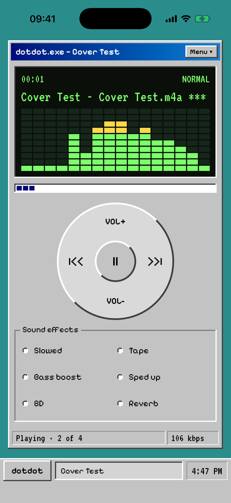
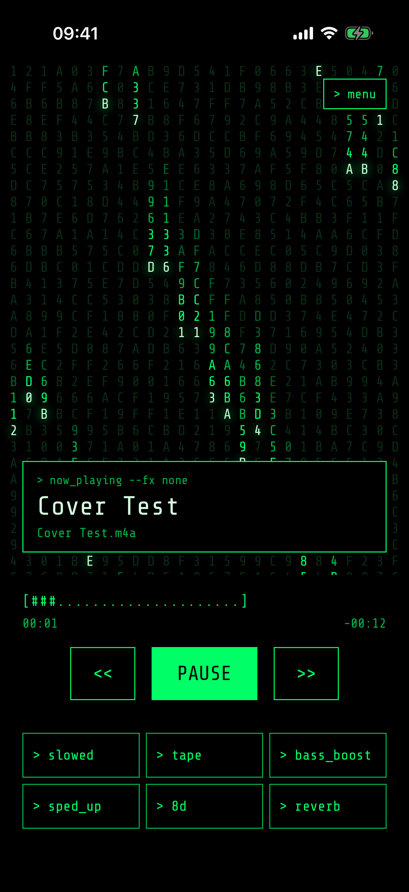
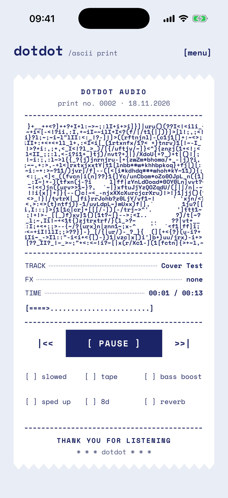
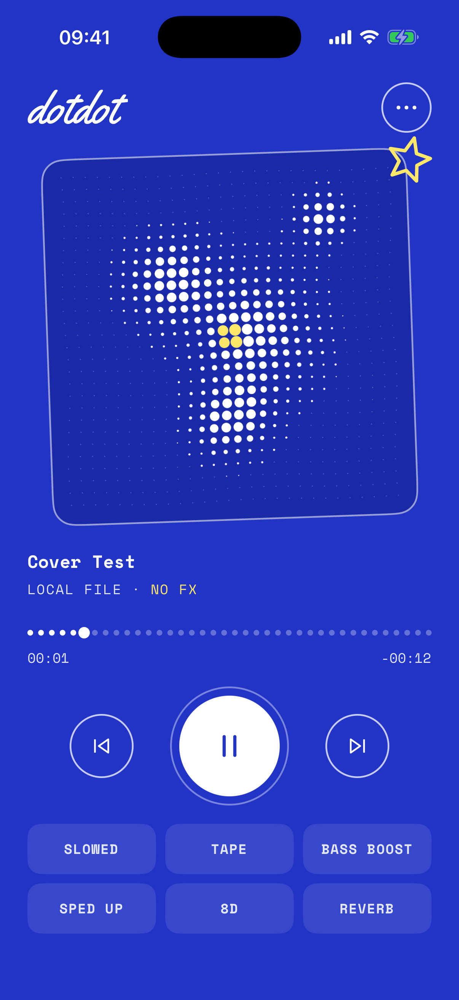

# dotdot

Music player for iOS with audio presets and switchable skins.

https://github.com/user-attachments/assets/3ea94b1f-a62e-49c9-a4e0-adc77e5549b4

| Pixel Desktop | Code Rain | ASCII Print | Cobalt Dots |
|---|---|---|---|
|  |  |  |  |

## Tech

- SwiftUI, Swift Concurrency, Observation
- AVAudioEngine: varispeed, reverb, EQ and HRTF spatial audio
- Accelerate (vDSP) for FFT
- Core Haptics
- No third-party dependencies
